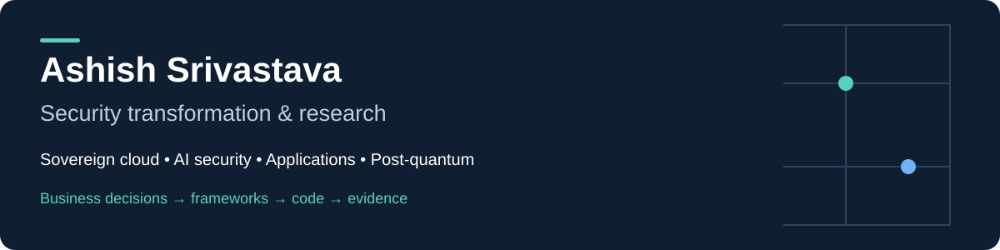

# Ashish Srivastava

**vCISO advisory · Security transformation · AI assurance**

I help enterprise leadership connect **security, risk, governance and compliance** to business priorities, accountable controls and evidence.

[**Visit my executive landing page**](https://cybersmeashish.github.io/) ·
[30 business problems and service scopes](https://cybersmeashish.github.io/#agenda) ·
[A scoped 90-day delivery roadmap](https://cybersmeashish.github.io/#roadmap) ·
[Work with Ashish](https://cybersmeashish.github.io/#engage)

I build security research, reference designs, and tools that connect technical controls to business decisions. My focus spans **sovereign and disconnected cloud, sovereign landing zones, Sovereign AI and security, security transformation, application security, ethical hacking, and post-quantum readiness**.

**The question behind the work:** what can this system reach and do, who owns that authority, and what evidence shows the control works?

## Start here

| If you are reviewing… | Begin with… |
| --- | --- |
| Security strategy and industry adaptation | [Transformation framework](https://github.com/cybersmeashish/ashish-vciso-repo) and [industry decision maps](https://github.com/cybersmeashish/ashish-vciso-repo/blob/main/industry-decision-maps.md) |
| Engineering and control behavior | [Sovereign AI](https://github.com/cybersmeashish/sovereign-AI), [agent security tools](https://github.com/cybersmeashish/cybernonics_tools), and [authorization cases](https://github.com/cybersmeashish/secure-coding-examples) |
| Research and emerging risks | [Connected research](https://github.com/cybersmeashish/Ashish-research) and [post-quantum inventory](https://github.com/cybersmeashish/crypto-implementations) |

## Sovereign infrastructure and national cyber capability

My research connects **local security autonomy, data and operator boundaries, key custody, controlled offline promotion, supplier dependencies, evidence disclosure, and recovery**.

[Sovereign & disconnected cloud](https://github.com/cybersmeashish/sovereign-disconnected-cloud-security) · [Sovereign landing zone](https://github.com/cybersmeashish/sovereign-landing-zone) · [National security frameworks](https://github.com/cybersmeashish/national-security-frameworks)

## Industry workspaces

| Industry focus | Decisions and future material |
| --- | --- |
| [Government](https://github.com/cybersmeashish/government-security) | Sovereign public services, local operational authority, accountable cyber capability |
| [BFSI](https://github.com/cybersmeashish/bfsi-security) | Transaction authority, customer boundaries, resilient operations, cryptographic dependencies |
| [Oil & Gas](https://github.com/cybersmeashish/oil-gas-security) | IT/OT boundaries, remote facilities, safety interfaces, local security and recovery |

[Industry work map](docs/industries.md) · [Contribution direction through 2030](docs/road-to-2030.md)

## Enterprise AI security product

[Enterprise AI Gateway](https://github.com/cybersmeashish/enterprise-ai-security-architectures/tree/main/products/enterprise-ai-gateway) is the first product in my
[Enterprise AI Security Architectures](https://github.com/cybersmeashish/enterprise-ai-security-architectures) portfolio: governed model access, tenant/document
boundaries, controlled synthetic tool authority and traceable AI governance evidence.

**Security reference preview v0.1.0:** 92 unique tests, 12 operational scenarios, 25 risk records,
20 control/test mappings and 14 governance templates. Large-scale and sovereign deployment blueprints
are distinguished from implemented local behavior.

[Product website](https://cybersmeashish.github.io/enterprise-ai-security-architectures/) ·
[Inspect the evidence](https://github.com/cybersmeashish/enterprise-ai-security-architectures/blob/main/evidence/README.md) ·
[Executive decision brief](https://github.com/cybersmeashish/enterprise-ai-security-architectures/blob/main/products/enterprise-ai-gateway/docs/executive-brief.md)

## Modern SOC Design

[Modern SOC Design](https://github.com/cybersmeashish/modern-soc-design) connects **24 layers, 20 architecture patterns and 224 structured design constraints** across telemetry, data, detection, investigation, AI, response, sovereignty, recovery and workforce decisions.

[Layer catalog](https://github.com/cybersmeashish/modern-soc-design/blob/main/docs/layer-index.md) · [Architecture patterns](https://github.com/cybersmeashish/modern-soc-design/blob/main/docs/pattern-index.md) · [Executive brief](https://github.com/cybersmeashish/modern-soc-design/blob/main/docs/executive-brief.md).

**Stage:** reference architectures with locally checked planning and record-consistency tools. Patterns are distinguished from deployed SOCs and operational workload measurements.

## Selected work

| Project | Security decision | Inspectable evidence |
| --- | --- | --- |
| [Sovereign & disconnected cloud](https://github.com/cybersmeashish/sovereign-disconnected-cloud-security) | Local autonomy, transfer contracts, key custody and recovery | Architecture records, synthetic flow contracts and a tested capacity-planning reference |
| [Sovereign AI](https://github.com/cybersmeashish/sovereign-AI) | Placement, retrieval, agent authority, and disconnected operation | Python control plane, policy examples, schemas, and local tests |
| [Security tools and architecture labs](https://github.com/cybersmeashish/cybernonics_tools) | Agent decoys, attributable events, and network boundaries | Agent-honeypot implementation and architecture inspection tools |
| [Application authorization](https://github.com/cybersmeashish/secure-coding-examples) | An identifier must not cross a tenant or object boundary | Vulnerable baseline and nine synthetic regression tests |
| [Post-quantum readiness](https://github.com/cybersmeashish/crypto-implementations) | Cryptographic dependency, ownership, and migration decisions | Read-only inventory review, nine tests, and NIST-linked decision guide |
| [Security transformation](https://github.com/cybersmeashish/ashish-vciso-repo) | Turn a business concern into an owned control and evidence gate | Reusable playbook, fourteen industry scenarios, and control-evidence matrix |
| [Connected security research](https://github.com/cybersmeashish/Ashish-research) | Relate standards and design choices to a bounded threat model | Primary-source notes, synthetic scope, executive briefs, and research agenda |

## One connected research story

[Sentinel Logistics](https://github.com/cybersmeashish/Ashish-research/tree/main/weeks/01-system-and-asset-inventory) begins with a customer order service and an AI assistant. It connects identity and application permissions to retrieval, tool authority, cloud placement, cryptographic dependencies, monitoring, and recovery.

The industry workspaces extend those questions into synthetic public-service, financial-transaction, and remote industrial-operation scenarios. Sovereign infrastructure supplies the shared boundary and local-autonomy decisions; sector owners define permitted actions, operating constraints, and acceptance evidence.

I publish the source, scope, intended behavior, observed result, and open question. Reference tests are distinguished from production validation; upstream projects retain their authorship.

## Collaborate

I welcome scoped collaboration on **sovereign infrastructure, disconnected security operations, industry security transformation, architecture reviews, AI assurance, post-quantum readiness, workshops, and applied research**.

[Work with me](docs/work-with-me.md) · [Complete public repository catalog](docs/repository-catalog.md) · [Research vision](docs/vision-and-research.md) · [Evidence guide](docs/evidence-guide.md)
